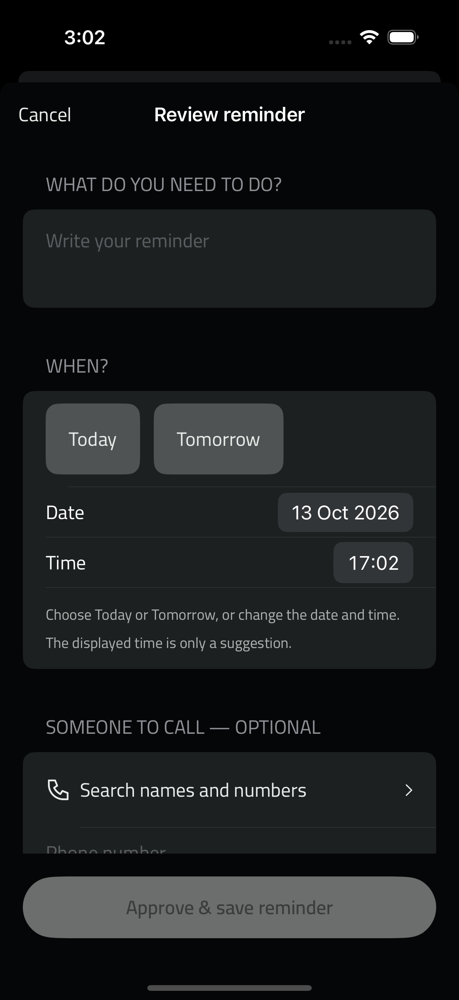
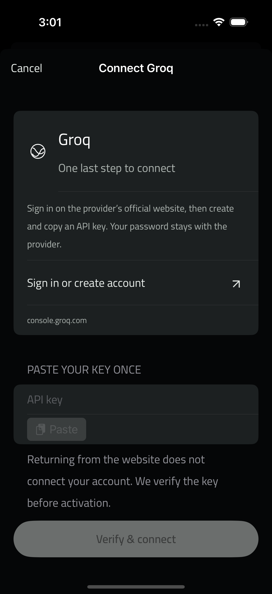
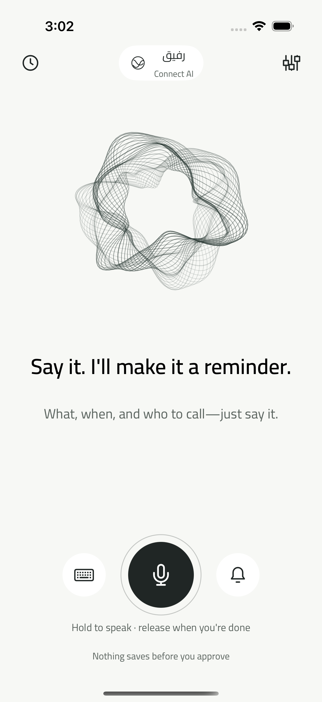
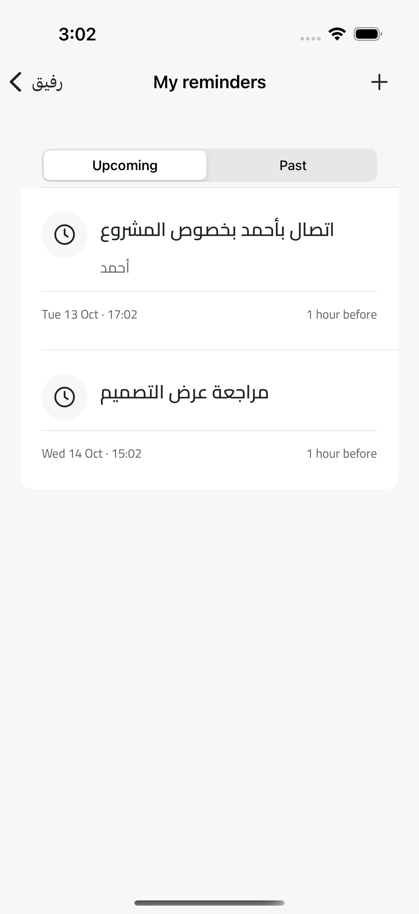
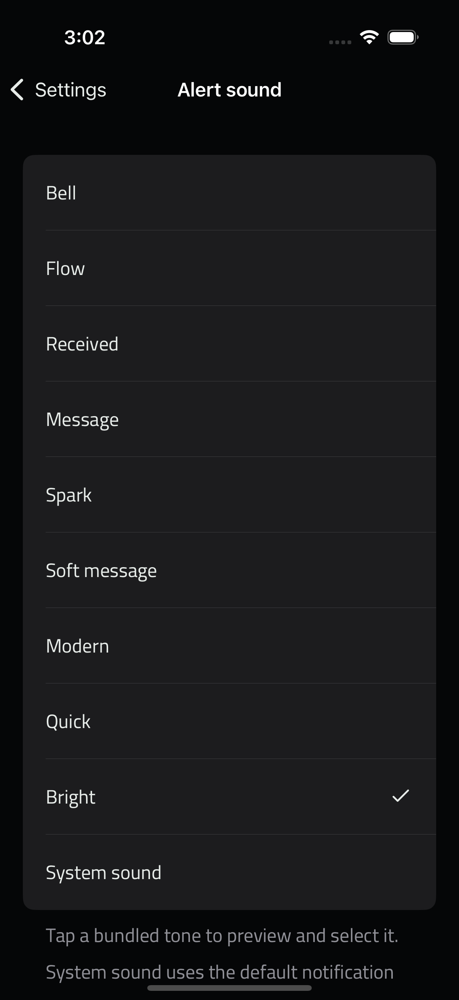
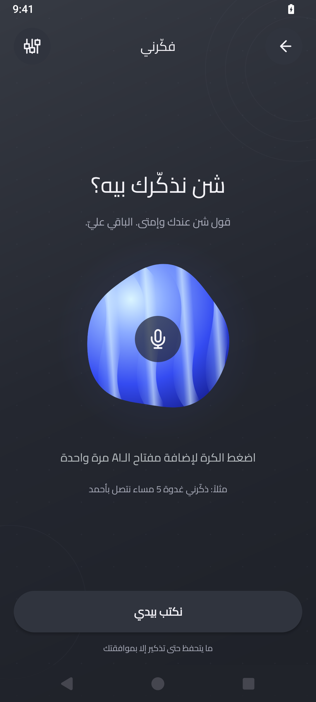
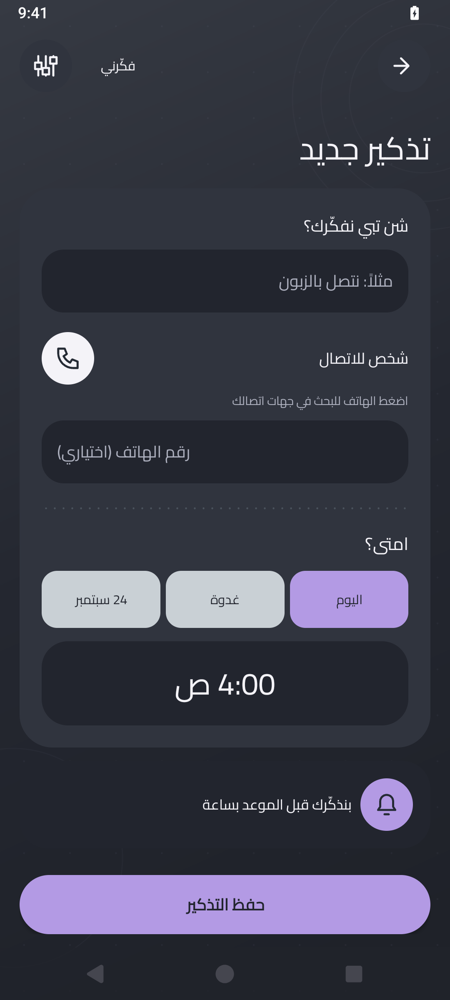
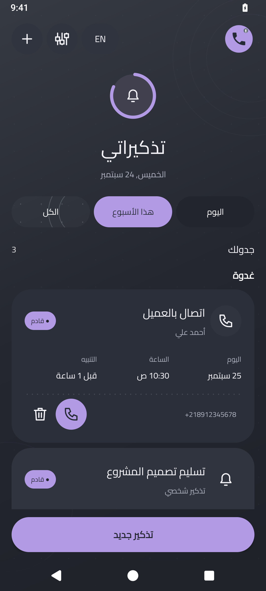

<div align="center">

# فكّرني · Fakkerni

### Say what you need to do. Review it. Get reminded.

[](#install)
[](ios/README.md)
[](https://github.com/mohamedkbay/fakkerni/releases/latest)
[](https://github.com/mohamedkbay/fakkerni/releases/latest/download/fakkerni.apk)

**[Download the latest APK](https://github.com/mohamedkbay/fakkerni/releases/latest/download/fakkerni.apk)** · [All releases](https://github.com/mohamedkbay/fakkerni/releases) · [Report an issue](https://github.com/mohamedkbay/fakkerni/issues)

**[iPhone / iPad setup](ios/README.md)** · [Download iOS source project](https://github.com/mohamedkbay/fakkerni/releases/latest/download/fakkerni-ios-source.zip)

<br />


**v1.6.0** — A native iPhone and iPad companion. The Android APK remains v1.5.1.

</div>

---

Fakkerni is a native Android reminder app with a SwiftUI companion for iPhone and iPad, built for quick, Arabic-first capture. Hold the microphone, speak in Libyan Arabic, review the written draft, and approve it. You can also type a reminder without an AI key or internet connection. Reminders alert you **one hour before** the event. Each platform keeps its own local reminders.

> “غدوة الساعة 5 العشية ذكّرني نتصل بأحمد.”

## Native iOS screens

Real iPhone Simulator captures of the iOS companion, using synthetic reminders. The app supports both Arabic and English; these captures use English for the documentation.

<table>
<tr><th>Speak or type</th><th>Review before saving</th><th>Connect your AI</th></tr>
<tr>
<td></td>
<td></td>
<td></td>
</tr>
<tr><th>Light appearance</th><th>Your reminders</th><th>Nine alert sounds</th></tr>
<tr>
<td></td>
<td></td>
<td></td>
</tr>
</table>

[View the screen-tour GIF](docs/media/ios/screen-tour.gif) — a slideshow of real Simulator screenshots, not a recording of the assistant animation. [iPad and large-text captures](docs/media/ios/).

<details>
<summary>Archived Android screens (v1.3)</summary>

<table>
<tr><th>Voice assistant</th><th>Review and edit</th><th>Reminders</th></tr>
<tr>
<td></td>
<td></td>
<td></td>
</tr>
</table>

[Watch the short GIF tour](docs/media/app-tour.gif). These are archived captures of the v1.3 interface, **not** screenshots of v1.5.1. No Android emulator image was available on the build machine for new device screenshots.

</details>

## What it does

- **Voice to reminder:** Transcribes Arabic speech, proposes an Arabic task title and local date/time, then waits for your approval. Nothing is scheduled directly from AI output.
- **One active AI:** Connect Groq, OpenAI, or Gemini on a dedicated page. Store more than one key, but activate only one provider at a time. A connected provider switches with one tap.
- **Simple sound choice:** Pick one of nine compact, user-supplied sounds with an in-app preview. Android also offers its phone-tone picker; iOS offers the system default sound. iOS alerts schedule automatically when you approve a reminder, with no test button in the app.
- **Local contacts:** Search Arabic or English names and phone numbers. When speech mentions a contact, the app matches it locally; it never uploads the address book. The call action opens the dialer, not an automatic call.
- **Local alerts:** Android uses exact alarm-clock scheduling and its lock-screen card. iOS uses system-scheduled local notifications and the native notification card. Permissions, sound, and Focus/DND settings apply.
- **Calm interface:** Dark and light modes, Cairo typeface, English digits `0–9` throughout, and locally rendered Morphicons animations.

The app name remains **فكّرني** in both interface languages. The assistant name and theme can be changed in Settings.

## Install

### Android

1. Download [fakkerni.apk](https://github.com/mohamedkbay/fakkerni/releases/latest/download/fakkerni.apk) on a phone running Android 8 or newer.
2. Allow installation from the source Android asks about. To update an existing installation, install over it **without uninstalling**, so your reminders stay on the phone.
3. Grant notification and exact-alarm permissions, then use **Settings → Test in 10 seconds** with the screen locked.

The APK is signed with the same local development certificate as the previous release, but is not a Play Store build. Check the release page for the APK SHA-256. A local build signed with your own certificate may not install as an update over the published APK.

### iPhone and iPad

Download the [iOS source project](https://github.com/mohamedkbay/fakkerni/releases/latest/download/fakkerni-ios-source.zip), open `ios/Fakkerni.xcodeproj` in Xcode 16+, select your Apple Personal Team, and run on your own device. A free Apple Account requires re-signing/reinstallation after **7 days**. No App Store listing is required for this personal-device route.

The release also contains `fakkerni-ios-unsigned.ipa` for developers to sign. **It is not a directly installable public download.** See the [complete iOS installation and signing guide](ios/README.md), including notification behavior, platform differences, and testing evidence. The iOS app supports iOS 16+, has no Android data sync, and limits upcoming reminders to 60 to leave room for reliable local-notification scheduling.

## Connect AI

Open the assistant and tap the provider chip, or go to **Settings → AI connections**. Choose one of these supported voice providers:

| Provider | What the app uses | Get a key |
| --- | --- | --- |
| Groq | Whisper Large V3 Turbo + GPT-OSS 20B | [Groq Console](https://console.groq.com/keys) |
| OpenAI | `gpt-4o-mini-transcribe` + `gpt-4.1-mini` | [OpenAI platform](https://platform.openai.com/api-keys) |
| Gemini | `gemini-3.8-flash` for audio and draft extraction | [Google AI Studio](https://aistudio.google.com/app/apikey) |

Tap **Connect**, paste your key, and tap **Verify & connect**. The app verifies the key without sending a recording. After that, tap **Activate in one tap** to switch a previously connected provider. Only one is active; there is no automatic fallback to a different provider after an API failure. Availability, model permissions, and free-tier quotas are controlled by each provider. The basic key check does not guarantee access to every model. Groq users may need to enable the app's models in their [project limits](https://console.groq.com/settings/project/limits).

On iOS, **Sign in or create account** opens the provider's official account/key page in the system browser inside the app. Create or sign in to your provider account there, copy a key, then tap **Back to connection** to paste and verify it. The return control stays outside the provider page and works while it loads. Existing key holders can skip directly to the key step. Returning from the browser alone never activates a connection.

This is **bring your own API key**, not a universal “sign in with AI” service. Keys are encrypted using Android Keystore or saved in iOS Keychain, never bundled in release binaries, and never written to logs. A key in a personal mobile app is still less secure than a trusted backend; restrict and rotate keys at the provider when possible. Never post a key in an issue, screenshot, or commit.

Audio and spoken text go to the **active** provider only. Contacts and saved reminders stay local. Manual entry and already-scheduled notifications do not use an AI service.

## Alert sounds and lock screen

The following details describe Android. For iOS, see [notifications and sounds](ios/README.md#notifications-and-sounds): the same nine recordings are converted to CAF, the card follows iOS presentation, and System sound replaces Android's ringtone picker.

Settings offers nine named alert tones supplied for this project: **Bell, Flow, Received, Message, Spark, Soft message, Modern, Quick, and Bright**. The MP3 files were reduced to mono 24 kHz / 48 kbps (about 148 KB together). Tap a name to hear it. **Choose from phone sounds…** opens Android's notification-tone picker. Use the built-in 10-second alarm test to verify the choice on your actual phone. The app cannot override Do Not Disturb, muted alarm volume, disabled notifications, or manufacturer battery restrictions. Lock-screen content can be seen by others; review your phone's privacy settings.

Android fixes a channel's sound when it is created. Fakkerni uses stable app-provided sound URIs for the bundled tones and a distinct channel for each phone ringtone URI, so changing the selection does not try to mutate an existing channel. To recreate the compact files from the nine original MP3s, run `node scripts/prepare-alert-sounds.mjs /path/to/source-directory`. Original filenames are listed in that script. The original audio was supplied by the project owner; rights in third-party recordings remain with their respective owners.

## Build and test

Requirements: JDK 17, Android SDK 36, Build Tools 35.0.0. The Gradle wrapper is included.

```bash
git clone https://github.com/mohamedkbay/fakkerni.git
cd fakkerni
# Set ANDROID_HOME or sdk.dir in an untracked local.properties.
./gradlew :app:assembleDebug :app:testDebugUnitTest :app:lintDebug
```

The debug APK is at `app/build/outputs/apk/debug/app-debug.apk`. No API key is needed to build or run unit tests. Device instrumentation tests under `app/src/androidTest` are intended for an isolated test emulator, not a personal phone. See the [v1.5.1 release notes](docs/releases/v1.5.1.md) for verification details.

Morphicons assets are prebuilt; regenerate them only if needed with `npm ci --ignore-scripts && npm run icons`.

The iOS source is in [`ios/`](ios/README.md), including the checked-in Xcode project, a standalone tested Swift core, UI tests, and GitHub Actions for native Simulator/device builds.

## Architecture map

The repository includes an [Understand-Anything knowledge graph](.ua/knowledge-graph.json) covering the native Android and iOS apps, shared asset tooling, tests, build configuration, and documentation. Its guided tour follows capture → AI draft → local contact matching → approval → notification scheduling. See [coverage and limitations](docs/architecture-analysis.md). This is static source analysis, not proof of runtime behavior; the release notes record the actual build and test results.

## Credits and licensing

- [Morphicons](https://www.npmjs.com/package/morphicons): [MIT license](app/src/main/assets/MORPHICONS-LICENSE.txt)
- [Cairo](https://fonts.google.com/specimen/Cairo): [SIL Open Font License](docs/licenses/Cairo-OFL.txt)

No general license has yet been declared for the project source code; the third-party component licenses above still apply.
